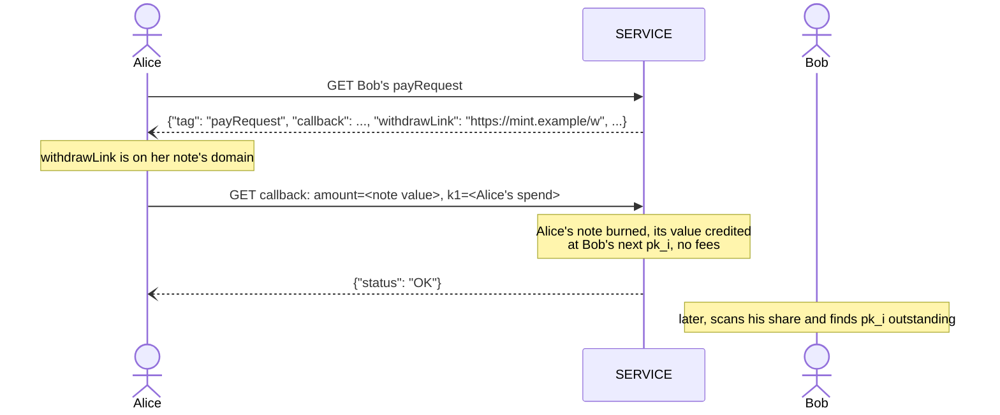

LUD-26: `LNURLcash` note derivation and Lightning Address.
====================================================

`author: dni` `co-authors: tbk (Thebora Kompanioni), thecryptodonkey` `status: draft`

---

This document extends [LUD-25](25.md) with deterministic key-path notes: derivation from a seed, recovery, watch-only export, and receiving notes through a Lightning Address. Terms such as `SERVICE`, `WALLET`, `Q`, `cp1`, `ck1`, rotate, split and merge are as defined in [LUD-25](25.md).

## Seed & derivation

`WALLET` SHOULD derive its key-path notes with [BIP-32](https://github.com/bitcoin/bips/blob/master/bip-0032.mediawiki). Each `SERVICE` gets its own root `S`, found with [LUD-05](05.md)'s domain-hashing steps under a purpose of its own, so that the two never share key material:

```
cashHashingKey   = derive(masterKey, m/139'/0)                      // LUD-05's step 1, own purpose
domainMaterial   = hmacSha256(cashHashingKey, full SERVICE domain)   // LUD-05's steps 2-3
(d1, d2, d3, d4) = first 16 bytes of domainMaterial as 4 uint32      // as LUD-05
S                = m/139'/d1/d2/d3/d4
```

`domain`, here and in every signed message below, is the string [LUD-25](25.md)'s canonical spend transaction commits to: `SERVICE`'s full domain name, lowercased. `d1`–`d4` are raw BIP-32 indices, as in [LUD-05](05.md), so any of them `≥ 2³¹` is a hardened step. Since a domain hosts exactly one mint ([LUD-25](25.md)), `S` and its counters are per domain, and seed plus domain recovers everything `WALLET` holds there.

Below `S`, keys follow [BIP-44](https://github.com/bitcoin/bips/blob/master/bip-0044.mediawiki)'s `account'/chain/index` layout, with a third chain for keys that may be shared:

```
S/a'/0/i       wallet:  every note WALLET mints, rotates or merges into, and a split's p1
S/a'/1/i       change:  a split's p2
S/a'/2/n'      share n, exported as its cx1
S/a'/2/n'/i    note i of share n, credited by SERVICE
```

A note's `sk_i` is the BIP-32 private key at its path, and its `Q` is `x(sk_i·G)` as in [LUD-25](25.md). An account `a` is an independent set of funds; most `WALLET`s only ever use account `0`. A share is made for one `username`, terminal or counterparty, numbered `0, 1, ...` in the order `WALLET` creates them.

Accounts and shares are hardened, so no account's or share's keys, public or private, can be derived from another's. Note indices are not hardened, as in BIP-44; since only a share's `cx1` is ever exported, a leaked `sk_i` exposes at most its own note, or its own share ([Watch-only export](#watch-only-export)).

`i` counts per chain and per share. `WALLET` advances the wallet and change counters once per key it uses there, a mint's key or a rotate/split/merge's replacement key alike, and only once `SERVICE` has credited it. After an error or an unknown outcome, `WALLET` MUST retry with the same `p1`/`p2` (a completed request returns its original response, [LUD-25](25.md)) or reuse them in its next request, so that failed requests leave no unused index behind. Only `SERVICE` picks indices on a share ([Crediting](#crediting)): `WALLET` MUST NOT name a share's key as a resulting note itself, so the two never collide.

### Recovery

To recover from seed alone, `WALLET` re-derives `pk_0, pk_1, ...` on each chain and each share of each known `SERVICE`, and GETs the withdraw LNURL with `?p=cp1<pk_i>` ([LUD-25](25.md)), stopping after a gap limit of consecutive unused indices, 20 unless the user configures otherwise. An index is used if `SERVICE` answers it with a note or with `{"status": "ERROR", "reason": "already in use"}` (a burned note); any other error is retried, never counted as unused. `WALLET` may binary-search the boundary instead of walking it. Accounts and shares are discovered like [BIP-44](https://github.com/bitcoin/bips/blob/master/bip-0044.mediawiki#account-discovery)'s accounts, `a = 0, 1, ...` and `n = 0, 1, ...`, stopping after 5 consecutive ones with no used index. A registered share that has not received a payment yet holds nothing, so the scan cannot see it; if `WALLET` later registers it again, `SERVICE` answers `cx1 already used` ([Registration](#registration)), and `WALLET` moves on to the next share. As in BIP-44, shares beyond 5 consecutive empty ones are lost to recovery, so `WALLET` SHOULD NOT create a share while 5 consecutive shares before it are still empty. Recovered notes are spendable immediately, since a key-path `ck1` is deterministic.

`SERVICE` MAY rate-limit this scan with `{"status": "ERROR", "reason": "rate limited"}` ([LUD-01](01.md)).

Bearer and script-path notes need their preimage or script tree, which the seed does not determine; `WALLET` MUST back those up by other means, or rotate them into key-path notes.

### Watch-only export

A share's [extended public key](https://github.com/bitcoin/bips/blob/master/bip-0032.mediawiki#extended-keys) (xpub), written `cx1`, lets a `SERVICE`, companion device, bookkeeping tool or point-of-sale terminal enumerate the share's notes with plain BIP-32 public derivation (`CKDpub`), without being able to spend them:

```
cx1 = bech32m("cx", chaincode (32 bytes) || P (33 bytes, compressed))   // BIP-32's order, 113 characters
```

using [BIP-350](https://github.com/bitcoin/bips/blob/master/bip-0350.mediawiki)'s bech32m. `WALLET` MUST NOT export any extended key but a share's `cx1`, and SHOULD use a fresh share for every party it hands one to, so that each party only ever sees what arrived through its own share. Since that party can watch the share, `WALLET` SHOULD rotate each note it finds there into a wallet note promptly.

> [!WARNING]
> As with any non-hardened xpub held by others, a leaked `sk_i` of a share, together with its `cx1`, exposes every other note still on that share. Other shares and the wallet and change chains are unaffected, which is one more reason to sweep received notes promptly.

## Lightning Address auto-mint

Once `WALLET` registers a `cx1` against a `username`, `SERVICE` publishes an ordinary [LUD-16](16.md) Lightning Address at `https://<domain>/.well-known/lnurlp/<username>` and mints automatically for every payment it receives there into the share's next unused `pk_i`, exactly as if `WALLET` had supplied `comment = cp1<pk_i>`. `WALLET` finds what arrived by scanning the share, as in recovery.

Its `payRequest` carries the same `withdrawLink` and `Mint fees` as the mint `payRequest` ([LUD-25](25.md)), and the note credited at `pk_i` is worth the amount paid minus those fees. It MUST NOT set `commentAllowed`, since a `comment` would never reach `WALLET` and could never select the note. For the same reason a `+<tag>` ([LUD-16](16.md)) is ignored: a payment to `<username>+<tag>` auto-mints into `<username>`'s share like any other, and `SERVICE` MUST refuse to register a `username` containing `+`.

`SERVICE` MUST serve its mint `payRequest` at the Lightning Address `mint@<domain>` and refuse `mint` as a `username`, so that `WALLET` finds the `withdrawLink` and `Mint fees`, address fee included, from the domain alone before registering.

### Registration

`WALLET` registers at the very Lightning Address it is claiming, so `dni@mint.example` is all it needs to know:

```
GET    https://<domain>/.well-known/lnurlp/<username>    // {"status": "ERROR", "reason": "unknown user"} while free
POST   https://<domain>/.well-known/lnurlp/<username>    // register:   cx1=<cx1>&sig=<hex>
PUT    https://<domain>/.well-known/lnurlp/<username>    // update:     cx1=<new cx1>&sig=<hex>&newsig=<hex>
DELETE https://<domain>/.well-known/lnurlp/<username>    // unregister: sig=<hex>
```

Parameters are sent `application/x-www-form-urlencoded`, so a browser `WALLET`'s POST needs no CORS preflight; `SERVICE` MUST still answer the preflight a PUT or DELETE needs, and MUST send `Access-Control-Allow-Origin: *` on every POST, PUT and DELETE response, not only on GET as [LUD-01](01.md) requires. Answers are `{"status": "OK"}` or `{"status": "ERROR", "reason": string}`, never an HTTP status code ([LUD-01](01.md)). Once registered, GET serves the ordinary [LUD-16](16.md) `payRequest`. `username` is case-insensitive and is signed and stored in lowercase. `SERVICE` MAY refuse a `username` it reserves, and MAY accept unsigned extra fields alongside `cx1`, such as an `npub` to serve the same `username` as a [NIP-05](https://github.com/nostr-protocol/nips/blob/master/05.md) identifier.

A `cx1` is not a secret, so `sig` proves ownership: a [BIP-340](https://github.com/bitcoin/bips/blob/master/bip-0340.mediawiki) signature by the share's own key `p` (the private key at `S/a'/2/n'`) over `sha256("LNURLcash:register:" || domain || ":" || username || ":" || cx1)`, or `sha256("LNURLcash:unregister:" || domain || ":" || username)`. `SERVICE` MUST reject the request unless it verifies against `x(P)` of the `cx1` being registered, or for unregister, the one on file. Binding `domain` stops a proof captured by one `SERVICE` from being replayed against another; binding `cx1` stops it from being replayed with another chain code or parity byte around the same `x(P)`.

A registration is never overwritten by a POST: `SERVICE` MUST reject one for a `username` that is already registered, or held for an unpaid address fee, with `{"status": "ERROR", "reason": "already registered"}`. It MUST also reject a POST or PUT whose `cx1` has the same `x(P)` as any `cx1` it has ever accepted before with `{"status": "ERROR", "reason": "cx1 already used"}`, so each share is registered once and a captured proof never applies again.

To move a registered `username` to a new `cx1` without ever freeing it, `WALLET` sends a PUT carrying two proofs: `sig` by the key on file over `sha256("LNURLcash:update:" || domain || ":" || username || ":" || cx1)`, binding the new `cx1` so the proof cannot redirect the `username` anywhere else, and `newsig` by the new `cx1`'s key over the same register message a POST would carry. `SERVICE` MUST verify both, reject a PUT for a `username` that is not registered with `{"status": "ERROR", "reason": "unknown user"}`, and then auto-mint from the new `cx1`'s first unused index onwards. An update charges no address fee. Notes already credited to the old share stay there, and `WALLET` keeps scanning it like any other.

Since shares cost `WALLET` nothing, `SERVICE` MAY charge an address fee per registration against spam: it answers a valid registration with `{"status": "OK", "pr": string}`, a BOLT-11 invoice for the fee, and MUST NOT publish the Lightning Address, auto-mint or answer [internal transfers](#internal-transfer) for that `username` until it settles. Until then the `username` is held for that registration only, and released if the invoice expires unpaid. `WALLET` MAY pay it from any wallet, or melt a note it holds at the same `SERVICE` ([LUD-25](25.md)). Unregistering costs and refunds nothing; registering again pays again.

`SERVICE` advertises the fee as a third value of `Mint fees` ([LUD-25](25.md)) in its mint `payRequest` at `mint@<domain>`: `Mint fees: <base_fee_msat>,<fee_ppm>,<address_fee_msat>` (e.g. `Mint fees: 1000,10,21000`, or `Mint fees: 0,0,21000` for an address fee alone). Without a third value, registering is free. `WALLET` SHOULD refuse to pay a `pr` that exceeds the advertised fee.

### Crediting

`SERVICE` MUST pick a share's `pk_i` when a payment settles, never when it issues the invoice, so that unpaid invoices leave no unused index on the share. Before crediting a payment at `pk_i`, `SERVICE` MUST confirm that `pk_i` is neither outstanding nor previously burned, and skip to the next index otherwise; a skipped index answers `already in use`, so recovery counts it as used and the same gap limit applies to shares.

## Internal transfer

A `WALLET` holding a note on the same `SERVICE` as a registered `username` MAY pay it without Lightning, by sending the note to the Lightning Address's `payRequest` `callback` ([LUD-06](06.md)) instead of asking for an invoice. It knows the two are the same mint when the `payRequest`'s `withdrawLink` is on its note's domain.

```
<callback>
  <?|&> amount=<msat>       // the note's full value, within minSendable and maxSendable
  &k1=<spend>               // ck1, cw1 or a bearer note's hex preimage, exactly one
```

This is a rotate ([LUD-25](25.md)) whose resulting note `SERVICE` picks: it handles the spend as a `callback` handles a rotate's (verification, `already in use`, retries), burns it, and credits its full value at the share's next unused `pk_i`, as [auto-mint](#crediting) would. `amount` MUST equal the note's value, as for a melt, so the payer always states what it pays; to pay part of a note, `WALLET` splits off the exact amount first. `SERVICE` answers `{"status": "OK"}` or `{"status": "ERROR", "reason": string}`. The payee's `pk_i` never leaves `SERVICE`, so the payer learns nothing about the payee's share, and since `SERVICE` picks it at crediting time, concurrent payers never collide.

Like a rotate, an internal transfer is free: `SERVICE` MUST NOT deduct mint fees or `base_fee_msat`. Likewise `SERVICE` MAY settle a melt ([LUD-25](25.md)) whose `pr` it issued itself internally, without routing fees, and SHOULD then credit the payee without mint fees, so that a `WALLET` that does not know this request pays nothing extra either.



## Test Vectors

[`26-vectors.json`](26-vectors.json) covers both [BIP-32](https://github.com/bitcoin/bips/blob/master/bip-0032.mediawiki#test-vectors) test vector 1 and 2 seeds: `SERVICE` roots, wallet, change and share notes of accounts `0` and `1` with each note's path, `sk`, compressed `pk` (of both `y` parities), 32-byte `Q` and `cp1`, each share's `cx1`, a `ck1` for a note whose `pk` has odd `y`, and register, update and unregister proofs.
